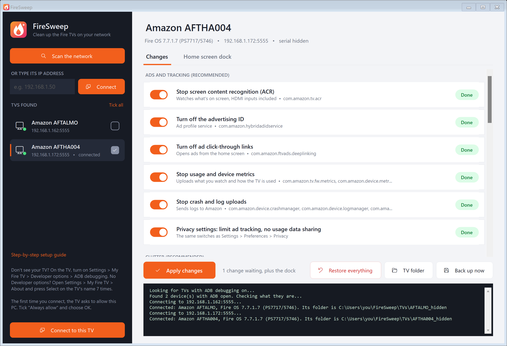
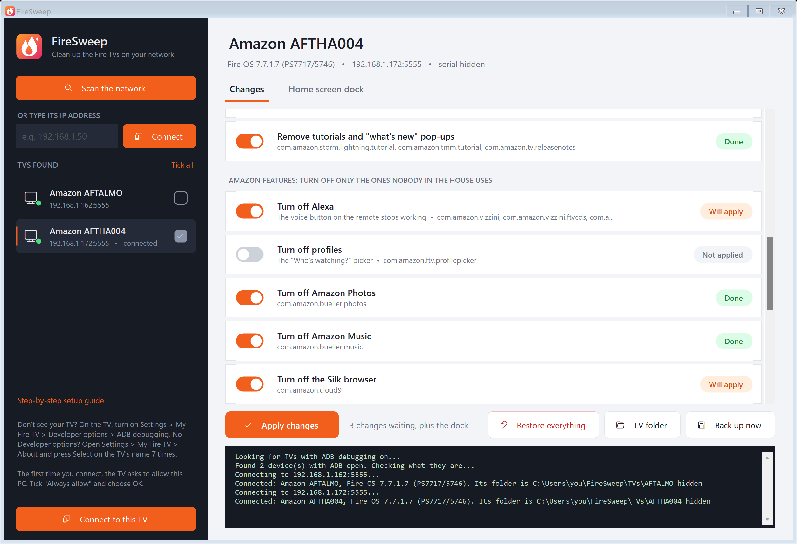
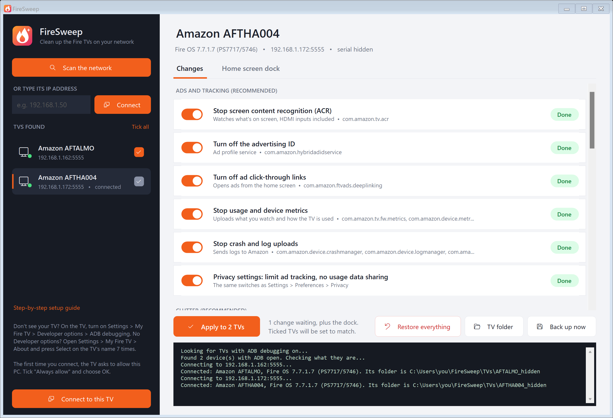
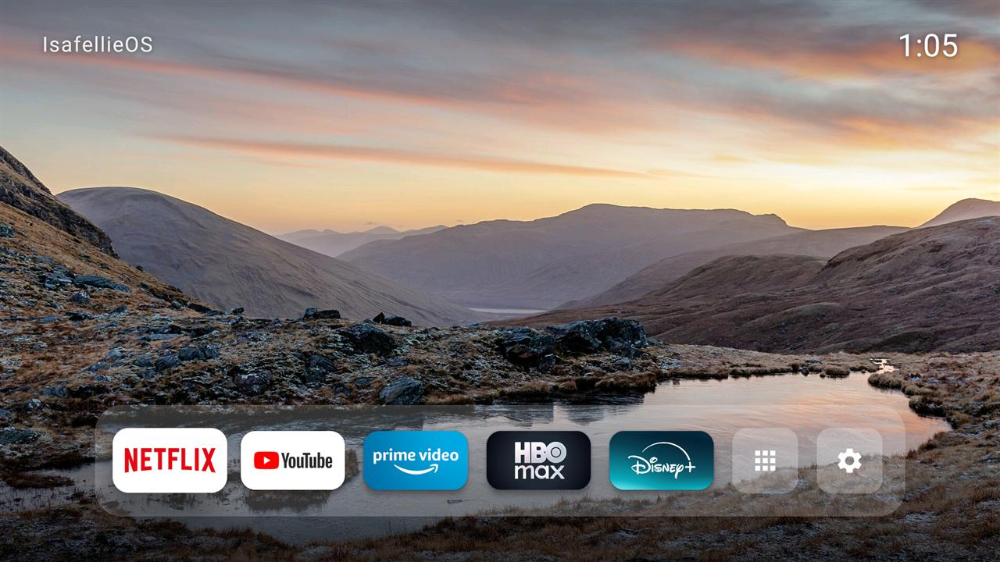
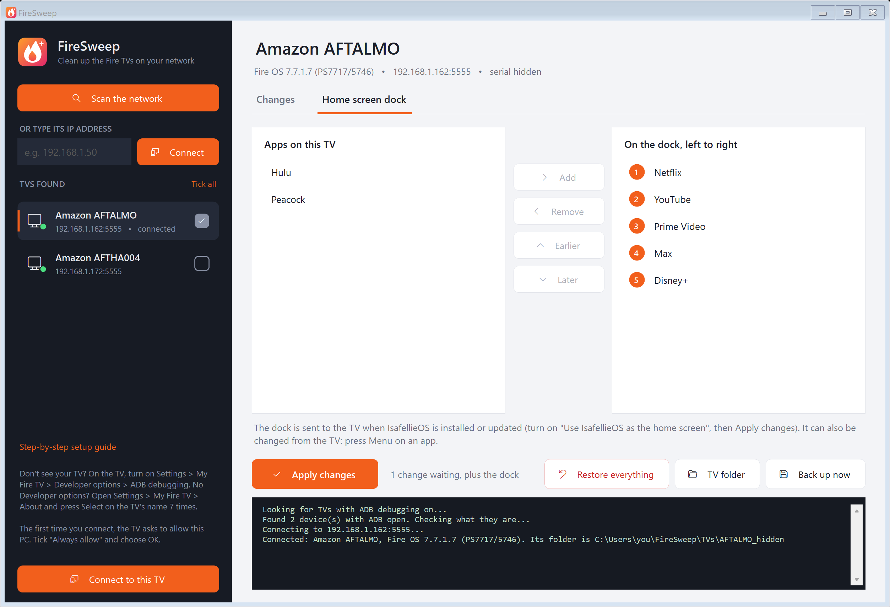
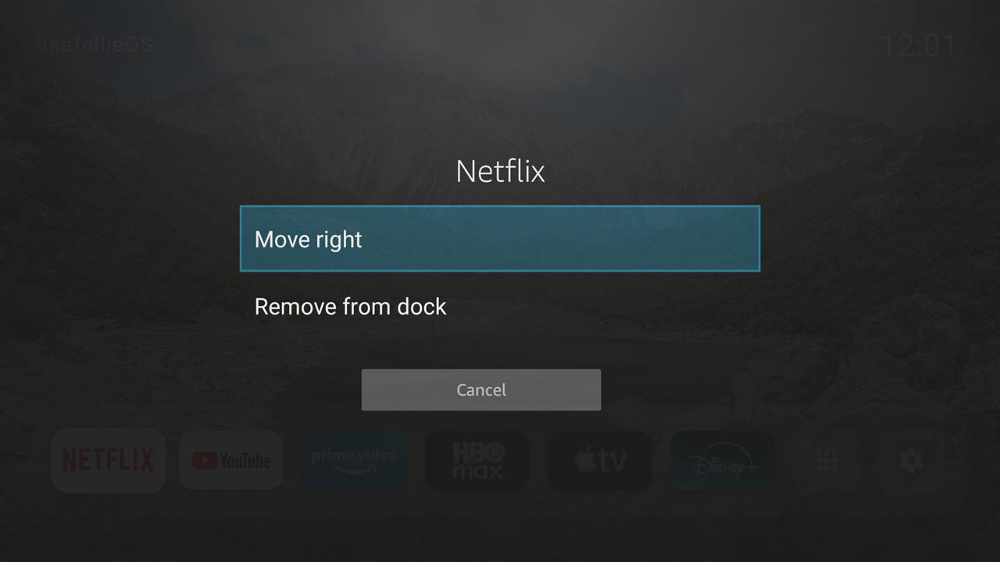

<p align="center"></p>

# FireSweep

**Clean up the Fire TVs on your network from a Windows PC.** FireSweep finds your Fire TVs, backs each one up, and lets you switch off Amazon's ads, tracking and clutter with a list of switches. It can also install a calmer home screen, IsafellieOS, with the dock apps you pick. Every change can be undone.



- **One file, nothing to install.** `FireSweep.exe` has adb and the home screen built in.
- **Finds your TVs.** It scans your network for Fire TVs with ADB debugging on, or you can type a TV's IP address.
- **Several TVs in one go.** Tick other TVs in the list and one Apply sets them all to match.
- **Backs up first.** Before the first change it saves each TV's package list, settings and a screenshot.
- **Switches off, never uninstalls.** Amazon apps are disabled, not removed. Untick anything to undo it.
- **Per-TV restore.** Each TV gets a folder with a change log and a double-click **Restore this TV.cmd**.

## Download

Get `FireSweep.exe` from the [latest release](../../releases/latest) and run it. Windows SmartScreen may warn that the app is unrecognized because it isn't code-signed. Choose **More info** → **Run anyway**.

It needs Windows 10 or 11 (it uses the .NET Framework that comes with Windows).

## Quick start

1. **Turn on ADB debugging on the TV.** Follow the [step-by-step guide](docs/enable-adb.md); it takes about a minute.
2. **Run FireSweep.** It scans your network automatically. If your TV doesn't show up, type its IP address under **Or type its IP address** and choose **Connect**.
3. **Allow your PC on the TV.** The first time, the TV asks *"Allow USB debugging?"*. Tick **Always allow from this computer** and choose **OK**.
4. **Pick your changes.** Switches that are on show **Done**. Flip one and it shows **Will apply** or **Will undo**. The recommended ads, tracking and clutter switches start on for a TV FireSweep hasn't changed before.
5. **Apply changes.** FireSweep shows what it's about to do and asks before changing anything.



### Several TVs at once

Set up one TV the way you want, then tick the box next to each other TV in the list (or **Tick all**). **Apply** becomes **Apply to N TVs**: each ticked TV is backed up first, then set to match every switch, dock included, and only gets the changes it actually needs. Each TV keeps its own log and restore script.



## What it can change

| Group | Switches |
|---|---|
| **Ads and tracking** (recommended) | Screen content recognition (ACR), advertising ID, ad click-through links, usage and device metrics, crash and log uploads, and the privacy settings (limit ad tracking, no usage data sharing) |
| **Clutter** (recommended) | Autoplaying featured previews, shopping overlays, Amazon miniTV, store demo content, tutorials and "what's new" pop-ups |
| **Amazon features** (only the ones nobody uses) | Alexa, profiles, Amazon Photos, Amazon Music, Silk, Amazon Kids, games hub, Matter smart-home, antenna live TV, ambient screensaver, automatic Fire OS updates |
| **Home screen** | Install IsafellieOS and make the Home button open it |

Only switches for apps that are actually on the TV can be flipped. The rest show **Not on this TV**. FireSweep never touches HDMI inputs, the tuner, settings, the keyboard, the Appstore, Amazon's own home screen or your installed apps.

Prefer to do it yourself? [Doing it by hand](docs/manual-steps.md) lists every adb command FireSweep runs.

## The IsafellieOS home screen

A quiet home screen: a slowly drifting nature wallpaper, a clock, and a dock of the apps you choose. Pick and order the dock apps on FireSweep's **Home screen dock** tab. You can also change them on the TV by pressing **Menu** on an app.



| Pick the dock on the PC | Or edit it from the remote |
|---|---|
|  |  |

Fire OS 7.7 doesn't let another app become the default home screen. IsafellieOS works around this with an accessibility service that opens it whenever the Home button is pressed or Amazon's home appears. You may see Amazon's home flash for a moment, and a future Fire OS update could block the workaround. **Restore everything** removes it either way.

## Undoing changes

- **Undo one change:** switch it back and choose **Apply changes**.
- **Undo everything:** choose **Restore everything**. It turns every Amazon app back on, puts the settings back, and removes IsafellieOS.
- **Without the app:** double-click **Restore this TV.cmd** in the TV's folder (**TV folder** button).

Each TV's folder sits next to `FireSweep.exe` in `TVs\<model>_<serial>` and holds:

| File | What it is |
|---|---|
| `backup-*\` | The TV's state before any change: package lists, settings, a screenshot |
| `*-by-isafellieos.txt` | The log of every change, which is what makes undo possible |
| `restore.ps1`, `Restore this TV.cmd` | Put the TV back without opening FireSweep |
| `activity.log` | Everything FireSweep did, with times |

## Tested on

- Fire TV Edition smart TVs (AFTHA004, AFTALMO), Fire OS 7.7.1.7

Other Fire TV devices on Fire OS 7 and 8 should work; switches for packages a device doesn't have just show **Not on this TV**. Reports from other models are welcome.

## Building from source

```powershell
.\build.ps1
```

This compiles `FireSweep.exe` with the C# compiler that ships with Windows; nothing else to install. It embeds adb from `%USERPROFILE%\platform-tools`, or downloads Google's platform-tools the first time if that's missing. It also embeds `launcher\IsafellieOS.apk`.

The home screen's source is in [`launcher/`](launcher). `launcher\build.ps1` builds it without Gradle and needs JDK 17 plus Android SDK build-tools 34 and platform 34 in one folder (`$env:ISAFELLIEOS_TOOLCHAIN`). It signs with a new key on first build, so a rebuilt APK can't update one signed by a different key: uninstall the old one first.

| Path | What |
|---|---|
| `src/` | The Windows app (C#, WinForms) |
| `launcher/` | IsafellieOS, the home screen (Java, no Gradle) |
| `docs/` | Guides and screenshots |

## Credits and licenses

- FireSweep and IsafellieOS: [MIT](LICENSE).
- adb is from the Android Open Source Project (Apache License 2.0) and is bundled unmodified. See [NOTICE](NOTICE).
- The wallpapers come from Wikimedia Commons under CC BY-SA, CC BY, CC0 and public-domain licenses. Authors and links are in [launcher/assets/CREDITS.txt](launcher/assets/CREDITS.txt).

FireSweep isn't affiliated with or endorsed by Amazon. Fire TV, Fire OS and Alexa are trademarks of Amazon.com, Inc. Use it at your own risk: it only disables and re-enables packages and settings, but you're changing your own device.
