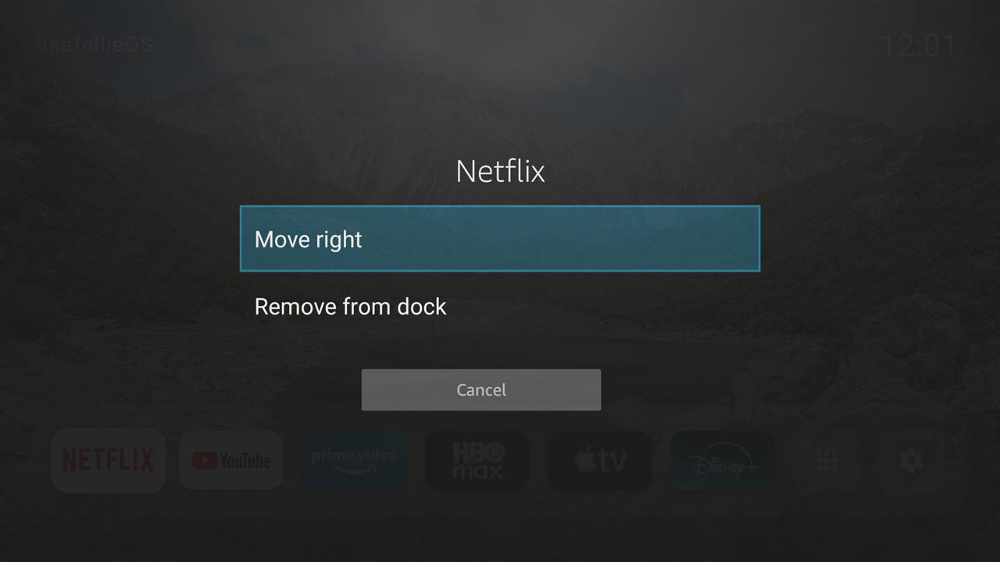
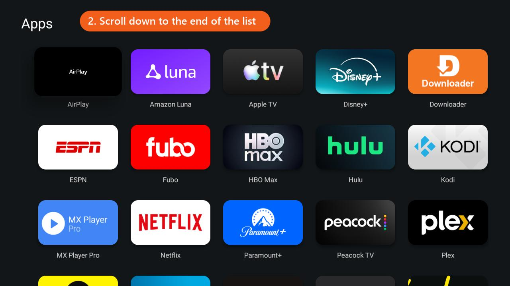
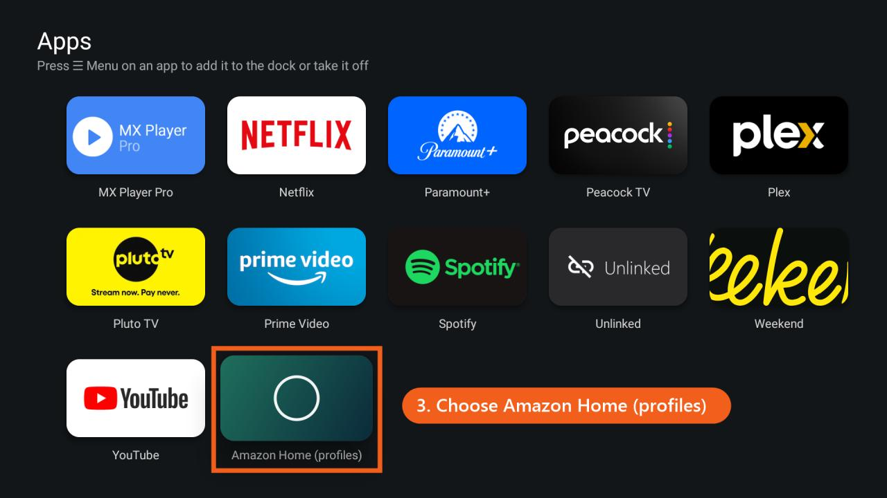

# Using the IsafellieOS home screen

IsafellieOS replaces Amazon's home screen with a wallpaper, a clock and a dock of your apps. Amazon's home is still there, and you can go back to it whenever you need it, for example to switch profiles or to reach a setting that only lives there.

## Getting around

| On the remote | What happens |
|---|---|
| **Left / Right** on the dock, then **Select** | Opens that app |
| **Select** on the grid tile (next to last) | **All apps**: every app on the TV |
| **Select** on the gear tile (last) | Settings: network, display, apps, Bluetooth, and **All Fire TV settings** |
| **Menu** (☰) on any app | Move it left or right on the dock, or add it to / remove it from the dock |
| **Home** | Back to IsafellieOS from anywhere |
| **Hold Home** | Opens Settings |

## Go back to Amazon's home screen

Use this for profiles, Alexa features, Live TV, or anything else that's only on Amazon's home.

1. On the IsafellieOS dock, open **All apps** (the grid tile).

   

2. Scroll down to the end of the list.

   

3. Choose the last tile, **Amazon Home (profiles)**.

   

Amazon's home opens and stays put while you use it. As soon as you open an app, or press **Home**, you're back on IsafellieOS.

**Just need a setting?** Open the gear tile and choose **All Fire TV settings**. It opens Amazon's full Settings menu without leaving IsafellieOS.

## Switch back to Amazon's home for good

In FireSweep, connect to the TV, switch off **Use IsafellieOS as the home screen** and choose **Apply changes**. IsafellieOS is removed and the Home button opens Amazon's home again. Your other changes, such as the ad and tracking switches, stay as they are.

To undo everything FireSweep did, choose **Restore everything** instead.
